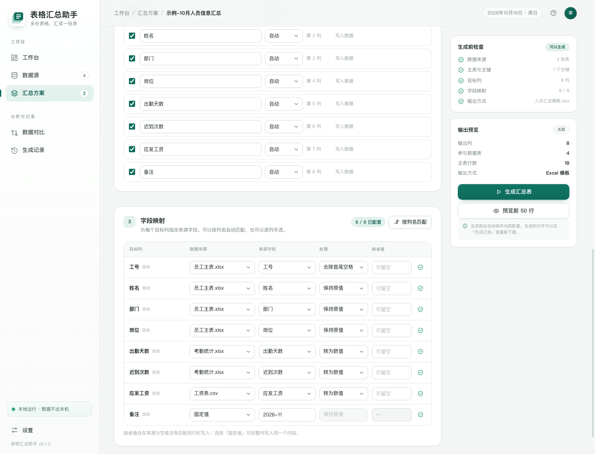
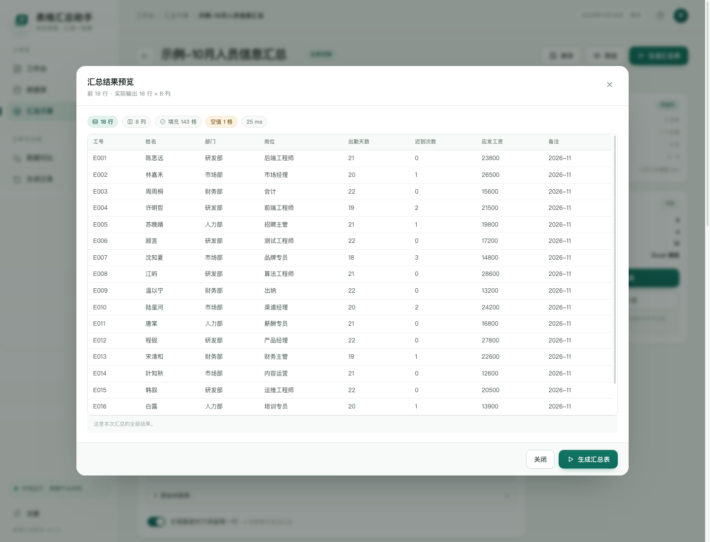
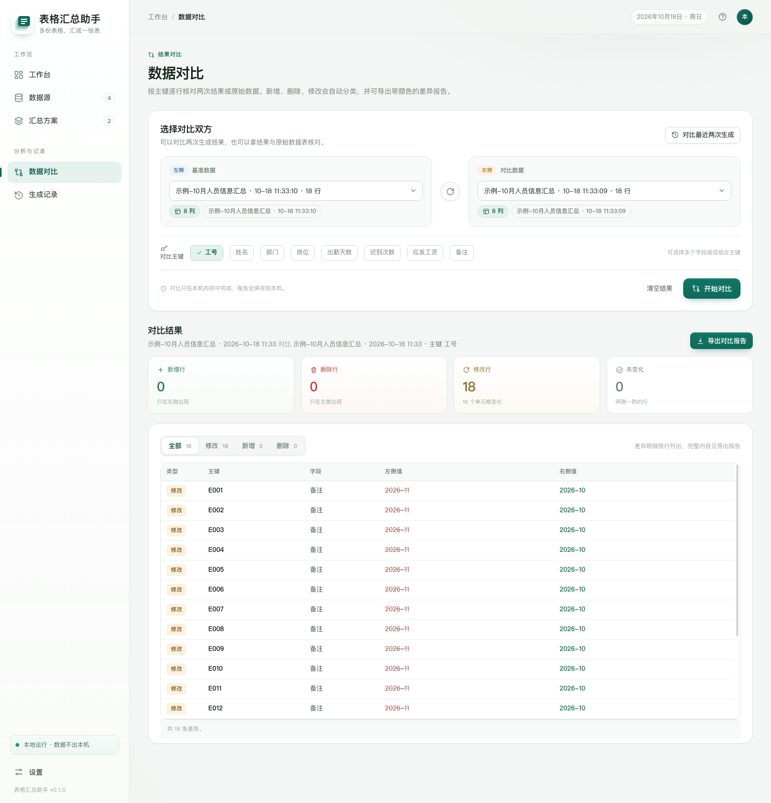

# 表格汇总助手

> **多份表格，汇成一张表。** 为办公室内网准备的本地 Excel 汇总工具：上传 Excel / CSV / Outlook 邮件与附件，按主键把字段汇总到指定模板，逐列指定来源，并支持历史结果对比。**全程离线，数据不出本机。**


## 下载安装包（给最终用户）

不想碰 Python 的话，直接用打包好的免安装版：

1. 打开 **<https://github.com/lirunwen/table-summary-assistant/releases/latest>**
2. 在 **Assets** 里下载 `TableSummaryAssistant-v*-windows-x64.zip`
3. 解压到任意目录（例如 `D:\表格汇总助手`），双击 **「安装.bat」**
4. 桌面与开始菜单就会出现「表格汇总助手」图标，以后**双击图标即可打开**

不想建图标也行：直接双击解压目录里的 **「启动.bat」**，浏览器同样会打开工作台。

目标电脑**不需要安装 Python，也不需要管理员权限**。全程离线，数据只落在解压目录的 `data\` 文件夹里。删除整个文件夹即完成卸载。

> 想换成别的位置：把整个文件夹搬走，再在新位置双击一次「安装.bat」，快捷方式会自动改指向新路径（旧图标会失效，重新生成时覆盖）。

> 这个 zip 由 GitHub Actions 在 `windows-latest` 上自动构建（见 `.github/workflows/build-windows.yml`），
> 构建前会先跑 `tests/test_regressions.py` 和 `tests/smoke.py`，测试不过就不会出包。
> 想自己发版：`git tag v0.2.3 && git push origin v0.2.3`，几分钟后 Release 里就有新包。

## 给文员的完整使用说明

- [Word 版：表格汇总助手-使用说明.docx](<guide/表格汇总助手-使用说明.docx>)（可修改、可打印）
- [PDF 版：表格汇总助手-使用说明.pdf](<guide/表格汇总助手-使用说明.pdf>)（直接发给同事）
- [一页速查：README-使用说明.txt](<README-使用说明.txt>)

说明按“先看这一页 → 上传文件 → 建方案 → 配每列来源 → 预览生成 → 数据对比 → 常见问题”的顺序编写，每一步都有界面截图和勾选清单。

## 为什么是本地 Web 应用

- **同事各自安装、各自使用**：服务只监听 `127.0.0.1`，不需要服务器，也没有账号体系。
- **断网可用**：没有 CDN、Web Font、图标库或统计脚本；CSS、JS、SVG 图标全部随程序分发。
- **无前端构建链**：原生 ES Modules + 手写 CSS，复制源码就能运行，不会遇到“构建产物丢了”的部署问题。
- **面向真实办公文件**：保留 Excel 模板的列宽、表头样式、合并单元格与公式列；邮件正文表格和附件自动展开。
- **状态可追溯**：每次运行生成独立结果文件与运行记录；对比报告可导出为带颜色的 Excel。

## 功能

- 数据接入：`.xlsx` / `.xlsm` / `.xls` / `.csv` / `.tsv` / `.txt`，Outlook `.msg` / `.oft`，邮件 `.eml`。
- 邮件解析：自动提取正文 HTML 表格、附件 Excel/CSV；附件在数据源树中单独展开。
- 目标模板：上传现有 Excel，保留版式；可选择工作表、调整表头行、覆盖或追加写入。
- 逐列映射：每一列指定“来源表 + 来源字段 + 处理方式 + 缺省值”，支持固定值、留空。
- **列公式**：映射里可直接写 Excel 风格公式（`=[单价]*[数量]`），支持 39 个函数，
  覆盖求和、乘法、文本拼接、条件判断、日期计算；能实时试算与预览。
- **日期格式自定义**：日期列可单独选 9 种展示格式（含中文年月日），写进 Excel 的是
  真日期值 + 显示格式，排序与日期计算照常可用。
- 两种汇总方式：
  - 主表关联：以主表行数为准，按主键（支持组合键）补齐其他表字段；
  - 纵向合并：多张同构表按列名上下拼接，支持同名列自动匹配。
- 运行前预览前 50 行，显示填充率、空值数、关联命中情况。
- 数据对比：两次结果或任意两张表，按主键找出新增 / 删除 / 修改，导出差异 Excel。
- 本地数据目录、运行记录保留策略、一键清理、离线设置。
- **桌面快捷方式**：`安装.bat` 一次性在桌面与开始菜单建好图标（图标取自 exe 本身），
  程序换目录后再运行一次即可改指向；页面「设置」里也能随时重建，不用找文件夹。
- **一键退出**：侧栏底部「退出应用」确认后停止服务并结束进程，命令行窗口随之关闭，
  不必去任务栏里翻那个黑窗口。
- 界面响应式，支持 1366 宽办公本与 1024 / 800 宽窗口。

| 数据源 | 字段映射 |
| --- | --- |
|  |  |

| 运行预览 | 数据对比 |
| --- | --- |
|  |  |

## 快速开始

### 方式 A：下载现成的 Windows 包（推荐给同事）

见上节「下载安装包」，解压即用，无需 Python。

### 方式 B：从源码自己打包 Windows 免安装版

PyInstaller 不支持跨平台交叉编译，**必须在 Windows 上构建**：

```bat
:: 在 Windows 10/11，安装 Python 3.11 或 3.12（64 位）后：
cd table-summary-assistant
packaging\build_windows.bat
```

脚本会自动建虚拟环境、装依赖、跑回归测试、打包、组装并压缩，最终产出
`dist\TableSummaryAssistant-vX.Y.Z-windows-x64.zip`，直接发给同事即可。

### 方式 C：源码运行（开发 / 内网 Python 环境）

```bash
# Python 3.11+
python -m venv .venv
# Windows
.venv\Scripts\activate
# macOS / Linux
source .venv/bin/activate

pip install -r requirements.txt
python app.py
```

浏览器访问 <http://127.0.0.1:9090>。也可以直接双击 `start.bat`（Windows）或运行 `./start.sh`。

### 无网络安装 Python 依赖

在一台可联网的 Windows 电脑：

```bat
packaging\prepare_offline_wheels.bat
```

把整个项目拷到内网电脑后：

```bat
py -3 -m pip install --no-index --find-links packaging\wheels -r requirements.txt
```

## 三步完成一次汇总

1. **接入数据源**：把文件拖进「数据源」。系统会自动识别工作表、表头行与数据行，可点开预览并修正表头行。
2. **配置汇总方案**：新建方案，上传目标 Excel 模板；选择主表与主键，添加关联表；在「字段映射」里逐列选来源。也可以按列名一键匹配。
3. **运行与对比**：点「生成汇总表」，下载填好的 Excel。下次运行后到「数据对比」，选两次结果与主键（如工号），导出差异报告。

示例文件在 `samples/`：员工主表、考勤、工资 CSV、人员汇总模板、带正文表格和附件的 EML。可直接拖进数据源试用。

## 字段映射里的公式与日期格式

「字段映射」每一步都有一列处理方式。除了原有的直接取值／去空格／转文本／转数值／
转日期／转大小写，每个目标列的右侧还多了一个 **`ƒx`** 按钮：点开就是这一列的公式
编辑器。

### 什么时候用

- 目标列在源表里**根本不存在**，但能用已有列算出来：`总额 = 单价 × 数量`、
  `全名 = 姓 & 名`、`月份 = TEXT([业务日期],"yyyy-mm")`。
- 需要在汇总时做**语义转换**：`IF([金额]>10000,"大额","常规")`。
- 想给可能出错的计算**留兜底**：`IFERROR([金额]/[数量],0)`。

启用公式后，该列不再看"来源表 + 来源字段"，取值完全由公式决定。处理方式和缺省值
对这个列也不再生效——公式就是这一列的全部规则。

### 怎么输入

| 要点 | 说明 |
| --- | --- |
| 开头 | `=` 可写可不写，`=[单价]*[数量]` 与 `[单价]*[数量]` 等价 |
| 引用字段 | 用**方括号**包住源表的表头名，如 `[单价]`、`[业务日期]`、`[数量]` |
| 字段名要求 | 必须与数据表表头**完全一致**（首尾空格会被忽略）；中文、空格、括号都支持 |
| 大小写 | 函数名不区分大小写，`sum` 与 `SUM` 一样 |
| 参数分隔 | 英文逗号 `,` 与中文逗号 `，` 都认，不用切输入法 |
| 文本拼接 | 用 `&`，如 `[姓]&[名]`；等价于 `CONCAT([姓],[名])` |
| 字符串 | 用英文双引号 `"大额"`，字符串里的双引号写两遍转义 |

编辑器里字段名不用手打：下方有**可点击的字段标签**，点一下插到光标处；上方还有
函数速查表，点函数名插入骨架。

### 支持哪些函数（39 个，分四组）

**数学计算（11）**
`SUM` `MAX` `MIN` `ABS` `INT` `MOD` `POWER` `SQRT` `ROUND` `ROUNDUP` `ROUNDDOWN`

```text
=ROUND([单价]*[数量]*1.13, 2)      含税价，四舍五入到分
=SUM([一月],[二月],[三月])          多列相加
```

**文本处理（11）**
`CONCAT` `LEFT` `RIGHT` `MID` `LEN` `TRIM` `UPPER` `LOWER` `SUBSTITUTE` `TEXT` `VALUE`

```text
=LEFT([工号],2)                    取工号前两位（WX）
=SUBSTITUTE([部门],"解决方案开发","解决方案部")
=TEXT([业务日期],"yyyy-mm")        把日期转成「2026-10」这样的月份文本
```

**条件判断（8）**
`IF` `IFERROR` `AND` `OR` `NOT` `ISBLANK` `ISNUMBER` `ISERROR`

```text
=IF([金额]>=10000,"大额","常规")
=IFERROR([金额]/[数量],0)           除零时给 0，而不是让整列变成 #DIV/0!
=IF(AND([部门]="LCS",[职级]="13A"),"重点","")
```

**日期计算（9）**
`TODAY` `NOW` `YEAR` `MONTH` `DAY` `DATE` `DAYS` `EDATE` `EOMONTH`

```text
=DAYS([离场日期],[入场日期])        在场天数
=EOMONTH([业务日期],0)              当月最后一天
=DATE(YEAR([业务日期]),MONTH([业务日期]),1)   月首
```

运算符：`+ - * / ^`（乘方）、`&`（拼文本）、`= <> > < >= <=`（比较）。
优先级与 Excel 一致：比较 < `&` < `+ -` < `* /` < `^`，`^` 右结合。

> 刻意不支持的东西：`VLOOKUP`／跨表引用、`A1:B2` 这类区域引用、正则。需要跨表取值的，
> 请先在「关联表」里配置好主键关系，汇总时字段就在同一行上了。

### 结果怎么预览

编辑器打开时就带着你选的数据表，输入公式后**边打字边校验**，并自动用**前 5 行真实
数据试算**：

```text
第 1 行   [单价]=12.5  [数量]=4   →  50
第 2 行   [单价]=8     [数量]=0   →  #DIV/0!  除数不能为 0
```

每行都会把公式**实际用到的输入值**一并列出来，所以对不上时能立刻看出是公式写错了
还是源数据本来就是空的。校验分三档：

- 语法错：状态条立刻标红并给位置（`第 6 个字符附近`），不打断输入；
- 引用了不存在的字段：标红并列出"当前可引用的字段"，可点击直接改；
- 通过：状态条变绿，显示识别到的引用字段清单。

保存方案（点「生成汇总表」前的那次校验）时还会再全量查一遍，挡住"存了个跑不通的方案"。

### 公式为空或算不出来会怎样

**公式为空**——如果只是没填，即 `ƒx` 打开了但输入框空着：

- 编辑器里：状态条提示「公式不能为空。可以填 =[字段名] 直接取原值。」，
  点「应用公式」不会关闭弹窗，也不会写入配置。
- 保存/运行时：直接**拦住**，报错 `列「总额」启用了公式但内容为空，请填写公式或关闭公式。`
  要清空这一列，请点弹窗左下角的「关闭公式」，而不是把公式删空。

**个别单元格算不出来**——不会让整次汇总失败（几万行里有一行除零，不该白跑一趟）：

- 该单元格写入 Excel 错误值：`#VALUE!` 类型不对、`#DIV/0!` 除零、`#REF!` 引用的字段
  在这一行缺失、`#NAME?` 不认识的函数、`#NUM!` 数值越界或嵌套过深；
- 运行结束在结果提示区汇总一条警告：

  ```text
  列「总额」有 3 个单元格公式计算失败（#DIV/0! ×2、#VALUE! ×1），首个：第 12 行 除数不能为 0。
  结果里已写入 Excel 错误值，可用 IFERROR 兜底。
  ```

  这样你不用在几万行里翻找 `#VALUE!`，能直接定位到第一处出错的行。
- 想彻底消掉这类警告，把公式包进 `IFERROR(..., 0)`（或想要的默认值）。

**整表都引用不到某个字段**——保存时就报错：
`列「总额」公式引用了不存在的字段 [单价]。可引用：工号、姓名、部门…`

### 日期格式自定义

日期列（处理方式选了「转日期」，或列类型是日期）的映射行里，会多出一个格式下拉框。
默认「跟随全局设置」，也可以给这一列单独指定：

| 选项 | 示例显示 |
| --- | --- |
| 跟随全局设置 | 由「设置 → 日期格式」决定，未设置则用 `YYYY-MM-DD` |
| `YYYY-MM-DD` | 2026-10-21 |
| `YYYY/M/D` | 2026/10/21 |
| `YYYY年M月D日` | 2026年10月21日 |
| `YYYY-MM-DD HH:mm` | 2026-10-21 14:30 |
| `YYYY-MM` | 2026-10 |
| `M月D日` | 10月21日 |
| `YYYYMMDD` | 20261021 |
| `DD/MM/YYYY` | 21/10/2026 |
| `MM/DD/YYYY` | 10/21/2026 |

应用后：

- 预览表里该列按所选格式显示，改了格式立刻重绘，不用重新生成；
- 生成的 Excel 里该列是**真日期单元格 + 对应数字格式**，不是文本。所以
  `YYYY年M月D日` 排出来是「2026年10月21日」，但它仍然能被排序、按日期筛选、
  参与日期计算——这一点和"先把日期转成字符串再写出去"有本质区别；
- 没配格式的日期列保持模板原有格式，不会被悄悄改掉。

## 支持的文件

| 类型 | 读取 | 写入 |
| --- | --- | --- |
| `.xlsx` / `.xlsm` | ✅ 多工作表、合并单元格、表头识别 | ✅ 模板填充 / 新建，`.xlsm` 保留宏 |
| `.xls`（97-2003） | ✅ 读取 | ❌ 模板请先另存为 `.xlsx` |
| `.csv` / `.tsv` / `.txt` | ✅ UTF-8 / GBK / GB18030 等自动识别 | —（结果输出为 Excel） |
| `.msg` / `.oft` | ✅ 主题、发件人、正文表格、附件 | — |
| `.eml` | ✅ 同上 | — |
| `.pst` / `.ost` | ❌ 请先在 Outlook 中另存为 `.msg` | — |

## 数据与隐私

```text
data/
├─ library/     上传的原始文件、邮件正文 CSV、附件
├─ templates/   目标 Excel 模板副本
├─ runs/        每次生成的汇总结果
├─ compares/    对比报告
├─ logs/        运行日志
└─ huiyi.db     方案、数据源、运行记录等元数据
```

- 默认只监听 `127.0.0.1`，同一内网的其他电脑也访问不到。
- 没有云服务、没有遥测、没有外部资源请求。
- 升级时保留 `data/`，替换程序文件即可；建议升级前整体备份。
- 可通过环境变量 `HUIYI_DATA_DIR` 指定其他数据目录。

## 目录结构

```text
app.py                  启动器（端口选择、日志、waitress、打开浏览器）
backend/                解析、汇总、模板写入、对比、API
web/                    原生前端（HTML / CSS / ES Modules / SVG 图标）
samples/                可试用的示例文件
tests/                  端到端冒烟测试、演示数据、截图工具
packaging/              Windows 打包脚本、spec、图标、离线 wheels 脚本
ARCHITECTURE.md         技术选型、模块、数据模型、数据流、部署方案
README-使用说明.txt      给最终使用者的简短说明
```

## 测试

```bash
pip install -r requirements-dev.txt

# 单元 / 回归测试（快，CI 会跑）
pytest tests/test_regressions.py -q

# 端到端冒烟测试（覆盖真实文件）
python tests/smoke.py
```

回归测试覆盖已修复的缺陷：百分比语义、日期歧义、数据库连接释放、追加模式对比行数、
跨站请求拦截、公式注入、空主键跳过、单元格上限、按需解析工作表。

`tests/test_formula.py`（68 条）覆盖列公式与日期格式：四类函数求值、运算符优先级、
空值语义、`IFERROR` 惰性求值、五种 Excel 错误值、七种语法错误的报错位置、
配置校验、运行期失败记账、以及九种日期格式写进 Excel 后的 `number_format`。

`tests/test_appcontrol.py`（10 条）覆盖安装与退出：快捷方式脚本的路径转义与
PowerShell 输出归一化、非 Windows 时的降级提示、退出钩子、以及
「监听 0.0.0.0 时拒绝远程退出」。

当前基线 **126 passed**。

界面另有三个无头浏览器巡检脚本（`tests/ui/`），共 41 项断言：公式弹窗与日期格式
（23）、模板入口（6）、退出与快捷方式（12，最后一个会把被测服务真的关掉）。

冒烟测试覆盖：上传解析、表头识别、模板上传、关联汇总、预览、表头调整、运行下载、
结果对比、结果对源表、纵向合并自动匹配、`.xls`、真实 `.msg`、公式注入防护、模板追加模式。

生成一套干净的演示数据：

```bash
python tests/seed_demo.py
HUIYI_DATA_DIR="$PWD/data/_demo" python app.py --no-browser
```

## 已知边界

- openpyxl 无法完整保留图表、图片、数据透视表等对象；复杂模板建议生成后用 Excel 打开核对一次。
- 源文件若含**公式**且从未在 Excel 中打开保存过，公式没有缓存值，读取时是空的。
  预览里会列出"全空列"提示，用 Excel 另存一次再上传即可。
- 暂不直接读取 `.pst/.ost`；也不解析邮件附件中的压缩包。
- 邮件正文表格对复杂的 `rowspan/colspan` 支持有限，建议先预览确认。
- 复杂多行表头需要先在数据源预览里指定表头行，暂不做多级表头合并。
- 单机单实例模型，不提供登录、权限与多人并发；如果改为 `--host 0.0.0.0` 暴露到内网，请自行增加访问控制。
- 单表读取上限 20 万行、300 列，单工作表 300 万个单元格（防内存爆掉）；单文件 100 MB、单次上传 200 MB、邮件附件 50 MB。
- `03/04/2026` 这种**日月顺序不明**的日期不会瞎猜：按原文保留并在警告里提示，需要统一请改成 `2026-03-04`。
- 「转为数值」对 `50%` 按数学语义折算成 `0.5`，并自动套百分比格式显示回 `50%`。
- 列公式只支持**按列引用**（`[字段名]`），不支持 `A1:B2` 区域引用、`VLOOKUP`
  这类跨表函数；需要跨表取值请先在「关联表」里配好主键。函数共 39 个，
  不在表里的函数会报 `#NAME?` 并在保存时被拦住。
- 桌面快捷方式记录的是**绝对路径**：把文件夹改名或搬走后图标会失效，在新位置
  再运行一次「安装.bat」即可。程序不写注册表，删除文件夹就是卸载（图标需手动删）。
- 页面「退出应用」只在监听 `127.0.0.1` 时可用。用 `--host 0.0.0.0` 共享给同事时，
  远程点击退出会被拒绝——不然谁都能把别人正在用的服务关掉。

## 更新日志

### 0.2.4

安装与退出流程补全（这两步之前是空白：解压后没有桌面图标，退出只能找黑窗口）：

- **`安装.bat`（新增）**：解压后双击一次，即在**桌面**与**开始菜单**创建「表格汇总助手」
  快捷方式，图标取自 `HuiYi.exe` 本身，工作目录与参数都已配好；创建完可直接启动。
  - 快捷方式指向 `HuiYi.exe` 而不是 `.bat`，双击不会先闪一个 cmd 窗口再拉起程序。
  - 中文路径全程不经过 cmd 传参：`安装.bat` 只调 `HuiYi.exe --create-shortcut`，
    PowerShell 脚本用 UTF-16LE + base64（`-EncodedCommand`）传入，绕开 OEM 代码页乱码。
  - 桌面路径用 `[Environment]::GetFolderPath('Desktop')` 取，兼容 OneDrive / 域环境重定向。
  - 幂等：重复运行覆盖旧图标；**程序换目录后再运行一次**，图标就会指向新路径。
- **页面内「退出应用」**：侧栏底部与「设置 → 快捷方式与退出」各一个入口，确认后
  调用 `POST /api/app/exit`，服务端延迟 0.45 秒执行 `os._exit(0)`——
  用 `sys.exit()` 只会结束当前线程，waitress 主循环还在，服务不会真停。
  - 退出后页面切换到「已退出」落地页，提示如何再次打开、数据在哪，
    不再让用户对着一个连不上的界面点来点去。
  - 只在监听回环地址时允许：`--host 0.0.0.0` 暴露到内网时拒绝远程退出，
    否则任何人都能关掉别人正在用的服务。
- **页面内「创建快捷方式」**：`POST /api/app/shortcut`，与 `安装.bat` 共用同一段代码；
  非 Windows 环境按钮置灰并给出说明，而不是弹一个看不懂的报错。
- **打包改善**：zip 改用系统自带 `bsdtar`（`tar -a`）生成。`Compress-Archive` 写中文
  文件名时不带 UTF-8 标志位（bit 11），换台非中文 Windows 或用第三方解压工具打开
  就是乱码目录名——安装第一步就卡住。CI 里加了 `tar` 失败自动回退。
- 打包内新增 `安装.bat`（同时提供 ASCII 名 `install.bat`）；启动器提示语与
  使用说明同步改成「先安装、再双击图标」。
- 测试：新增 `tests/test_appcontrol.py`（10 条）与 `tests/ui/check-app-control.mjs`
  （12 项断言，会真的把被测服务关掉再验证端口不再响应），全量 **126 passed**。
  CI 的测试步骤从单文件改成 `pytest tests -q`，新用例一并纳入出包门槛。

### 0.2.3

字段映射新增两项能力（第 3 步「字段映射」）：

- **列公式**：每个目标列多一个 `ƒx` 编辑器，可写 Excel 风格公式对源字段做二次计算
  再映射，支持 39 个函数（数学 11 / 文本 11 / 条件 8 / 日期 9）、`&` 拼接、
  比较运算与完整优先级；引用源字段用 `[字段名]`。
  - **不用 `eval`**：`backend/formula.py` 自己实现词法 + 递归下降语法 + AST，
    白名单函数表。用户输入永远不会被当代码执行。
  - **`IF` / `IFERROR` / `ISERROR` 惰性求值**：`IFERROR([a]/[b],0)` 在 `b=0` 时
    只算兜底分支，不会先炸再救。
  - **编译一次、逐行求值**：公式在进入行循环前编译为 AST，5 万行不会重复解析。
  - **错误不静默**：单行算不出来写入 Excel 错误值（`#DIV/0!` 等），并在运行结果里
    汇总"哪一列、多少行、第一个错在哪"；`ROUND` 用 `ROUND_HALF_UP` 而非 Python
    的银行家舍入，避免合同金额少一分钱。
  - **编辑器内实时校验 + 前 5 行试算**：边输入边报语法位置与缺失字段，试算表把
    「输入值 → 结果」并排显示。新增三个接口 `/api/formula/help|check|try`。
- **日期列自定义格式**：9 种预设（含 `YYYY年M月D日`、`M月D日` 等中文格式），
  逐列可选，默认「跟随全局设置」。写入 Excel 的是**真日期值 + 数字格式**，
  不是格式化后的文本，排序与日期计算照常可用。同一套 token 规则在前后端各实现一次
  （`_format_date` / `formatDateByPattern`），保证预览与产物一致。
- 映射模型新增三个字段：`formula_on`（布尔开关）、`formula`（公式正文）、
  `date_format`（格式键）。旧方案完全兼容——字段缺省即按原逻辑运行。
- 测试：新增 `tests/test_formula.py`（68 条）与 `tests/ui/check-formula-mapping.mjs`
  （23 项断言），全量 **116 passed**。

### 0.2.2

- **默认端口 8765 → 9090**。8765 属于高频冲突段（Jupyter、各类本地 mock server
  都爱用），首次启动就被挤到 9091 的情况不少。现在默认 9090，打包版启动器
  （`启动.bat`）显式传 `--port 9090`；若 9090 仍被占用，自动往后找 9091~9119，
  实际地址以黑色窗口打印的为准。
- 端口支持环境变量 `HUIYI_PORT` 覆盖（与 `HUIYI_DATA_DIR` 同一套写法）。
  非数字或越界值会打印提示并回退到 9090，不再直接抛异常。
- 修 `--help` / 参数错误在英文版 Windows 控制台崩溃：`argparse` 的构造原本早于
  `_safe_console()`，中文帮助文本在 cp1252 下会抛 `UnicodeEncodeError`。
  现在先修控制台编码，再解析参数。
- 同步文档：README、`README-使用说明.txt`、打包版使用说明与 `ARCHITECTURE.md`
  里的访问地址统一改成 `http://127.0.0.1:9090`。

### 0.2.1

修复（都会静默产出错误的表，所以优先处理）：
- **5 位纯数字不再被当成 Excel 日期序列号**。以前列类型选了「日期」时，工号
  `10001` 会被写成 `1927-05-19`，整列日期错掉且没有任何提示。裸数字无法区分
  「日期序列号」和「真实编号」，按本项目「歧义不猜」的原则改为原样保留；
  真正的日期单元格由 openpyxl 读成 `datetime`，不受影响。
- **欧式数字 `1.234,56` 不再被读成 `1.23456`**（差 1000 倍）。现在按分隔符位置
  判断小数点与千分位，并支持会计负数 `(100)`、空格千分位、全角标点与全角数字。
- 关联键的浮点误差：`0.1+0.2` 与 `0.3` 现在归一成同一个键，不再漏匹配。

性能（实测基线：5 万行 × 6 列）：
- 写 Excel `21.6s → 15.9s`：样式对象复用，不再每写一个单元格就 `new Alignment()`。
- 预览 `1.8s → 0.13s`（中小表第二次起）：新增解析结果缓存，按文件 mtime 自动失效；
  单表超过 40 万单元格不缓存，可用 `HUIYI_TABLE_CACHE_CELLS` 调整。
- 纵向合并按列名匹配改为预建索引，去掉逐行的 `list.index()`。
- 读取路径少做两趟全网格 trim。

界面与安全：
- 新增 `Content-Security-Policy`（`script-src 'self'`）：内联脚本与 `on*` 属性一律
  不生效；内联兜底脚本已移到 `web/js/boot-guard.js`。
- 快速切换页面时，过期的异步渲染会被丢弃，不再覆盖新页面或泄漏事件监听。
- 数据表索引加缓存，方案编辑页渲染不再反复重建全表索引。
- 补齐 CSS 里缺失的 5 个间距工具类（`gap-14` / `mt-12` / `mt-16` / `mb-10` / `mb-18`）。
- **新建方案时的「目标 Excel 模板」不再藏在最后一行下拉里**：改成三张并排卡片
  （新建空白表 / 用已有模板 / 上传新模板），上传可在弹窗内直接完成；有模板时默认选中，
  并显示表头行、列数与列名摘要，同时用三条规则写明写入方式。方案编辑器里未启用模板时，
  「目标表」顶部会出现一条虚线行动区，主按钮直达模板选择。

工程：
- 回归测试 27 → 48 条，新增日期序列号、多语言数字、浮点键、解析缓存、CSP 覆盖。
- 清理 `ingest.delete_source()` 中一段只计算、不生效的死代码。

### 0.2.0

修复：
- **追加写模板后，数据对比多读进模板原有行**（结果行数与对比行数不一致）。运行记录现在保存 `data_start`，对比从真正的写入起点开始读。
- **SQLite 连接从不显式关闭**，长期运行会堆积文件描述符与 `.db-wal` 锁。改为每次操作独立连接并 `finally: close()`。
- **`50%` → `50`** 的静默错误。改为 `0.5` + 百分比数字格式；日期 `03/04/2026` 不再按美式猜测。
- 公式注入防护漏掉 `-` 与前导空白/换行；改用 `lstrip` 判断 + `quotePrefix` 强制文本。
- 单工作表超过 300 万单元格时直接给出可读错误，而不是把内存吃光；读取时只解析被引用的工作表。
- `skip_empty_key` 从"存在但从不生效"变成真正生效，界面上加了开关。

加固：
- 本地服务增加 Host / Origin / `Sec-Fetch-Site` 校验，挡住跨站表单提交与 DNS rebinding。
- 上传体积在落盘**之前**就检查，不再先写满磁盘再拒绝。
- 散落在三处的 100/120/200/50 MB 魔数收敛到 `backend/config.py`。

工程：
- 新增 `tests/test_regressions.py`（26 条 pytest 用例）与 GitHub Actions 自动打包流水线。
- 新增 `LICENSE`（MIT）。
- 版本号 0.1.0 → 0.2.0。


## 技术栈

Python 3.11+ · Flask 3 · waitress · openpyxl · xlrd · extract-msg · SQLite · 原生 HTML/CSS/ES Modules。无需 Node.js，无前端构建步骤，无公网资源。

更多设计与实现细节见 [ARCHITECTURE.md](ARCHITECTURE.md)。
